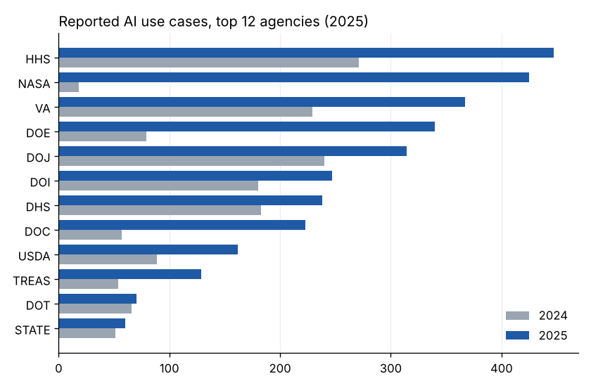
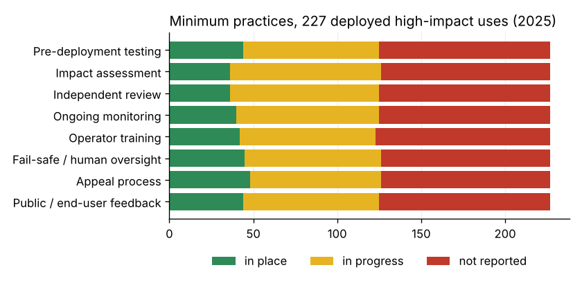

# Federal AI Use Case Inventory Explorer

**What are U.S. federal agencies actually doing with AI? This project analyzes OMB's consolidated 2024 and 2025 AI Use Case Inventories and turns them into a dashboard, text models and a search tool for ideas. It also includes a proposal compliance checker inspired by one of the inventory's own use cases.**

Every year, agencies must publish an inventory of their AI use cases, and OMB consolidates them on GitHub ([2024](https://github.com/ombegov/2024-Federal-AI-Use-Case-Inventory), [2025](https://github.com/ombegov/2025-Federal-Agency-AI-Use-Case-Inventory)). The raw files are wide, inconsistent between years, and hard to read. This repo:

- **downloads and normalizes** both years into one schema, mapping stage, impact and contracting values across the two years' different wordings;
- **analyzes** growth by agency, the generative AI share, high-impact AI, vendors and data quality;
- **checks** whether deployed high-impact AI reports the OMB M-25-21 minimum practices as in place;
- **models the text**: NMF themes, a topic classifier that suggests the missing `topic_area`, and similar-use-case search;
- **builds a static dashboard** in `docs/index.html`, ready for GitHub Pages;
- **checks proposals against solicitations**: requirement extraction plus a compliance matrix. This is modeled on the GSA inventory entry for an ML tool that evaluates vendor proposals against solicitation requirements.



## Key findings (2025 inventory)

| | |
|---|---|
| Use cases reported | **3,611** across 41 agencies (+69% from 2,133 in 2024) |
| Biggest jumps | NASA 18 → 425, DOE 79 → 340, DOC 57 → 223 |
| Generative AI | **858** use cases (24%). Treasury (60%) and DOE (44%) have the highest shares among larger reporters |
| High-impact AI | **445** use cases, 227 of them deployed. VA (215) and DOJ (114) account for three quarters |
| Minimum practices | Only **33 of 227** deployed high-impact uses report *all* practices in place. Most say "in progress" or leave the fields blank |
| Vendors | Microsoft is named 87 times; Google, Deloitte and Palantir follow at 17–18 each. 86% of rows leave the vendor blank |
| Data quality | 17% of rows have no topic area, 18% no AI classification, and 21% no description of outputs |



*2024 counted "rights- or safety-impacting" uses under M-24-10, while 2025 counts "high-impact" uses under M-25-21. The definitions differ, so compare the two years' figures with care. All data is self-reported by agencies.*

## Quick start

```bash
git clone https://github.com/SAADALKINANI/fed-ai-inventory-explorer.git
cd fed-ai-inventory-explorer
pip install -e ".[dev]"
pytest

fedai summary                       # downloads both inventories on first run (~15 MB, cached)
fedai dashboard --out docs/index.html
fedai similar "chatbot that answers public questions about benefits"
fedai compliance examples/proposals/solicitation.txt examples/proposals/proposal_vendor_a.txt \
      --html matrix.html --csv matrix.csv
```

```python
from inventory.data import load_inventory
from inventory.analysis import growth_by_agency, genai_by_agency
from inventory.textmodel import TopicClassifier, UseCaseSearch

df = load_inventory()                       # one normalized table, both years
growth_by_agency(df)
UseCaseSearch(df).query("summarize public comments on proposed rules")
```

## Text models

- **Topic classifier.** TF-IDF on 1–2 word phrases plus class-balanced logistic regression, trained on 2025 rows that report a topic. It reaches **64% accuracy** (macro F1 0.51) across 15 topics on a held-out 20%. That's a useful first suggestion, but not good enough to apply automatically. Most rows that are missing a topic also have no description, so only about 1 in 10 can be filled with confidence. That is a data-quality finding in itself.
- **Themes.** NMF over the descriptions finds clusters such as chatbots and knowledge search, anomaly detection and computer vision, code generation, geospatial and environmental monitoring, and translation and transcription.
- **Similar use cases.** Before building something, check whether another agency already has. Agencies are encouraged to reuse code, data and lessons.

## Proposal compliance checker

`inventory/proposal.py` extracts binding requirements from a solicitation: sentences containing *shall*, *must*, *required* and similar, with their section numbers. It then finds the best supporting passage in a proposal using TF-IDF similarity and key-term coverage, and labels each requirement **Addressed**, **Partially addressed** or **Not found**, quoting the evidence.

On the fictional sample solicitation (11 requirements):

| | Addressed | Partial | Not found |
|---|---|---|---|
| Vendor A (specific, responsive) | 10 | 1 | 0 |
| Vendor B (marketing language) | 0 | 1 | 10 |

It is a first-pass aid for reviewers. It speeds up building a compliance matrix, and every row shows its evidence so a person can verify it. It does **not** score or rank offerors. Source selection stays with the evaluation panel and the solicitation's stated criteria.

## Layout

```
inventory/
  data.py        download, normalize 2024 + 2025, minimum-practice status
  analysis.py    headline, growth, shares, vendors, data quality
  textmodel.py   topic classifier, NMF themes, similar-use-case search
  dashboard.py   static HTML dashboard
  proposal.py    requirement extraction + compliance matrix
  cli.py         `fedai` command
examples/proposals/   fictional solicitation, two proposals, generated matrices
docs/index.html       generated dashboard (enable GitHub Pages on /docs to publish it)
```

## Data and license

The inventory data comes from OMB's public GitHub repositories. It is U.S. government work, downloaded at runtime and not redistributed here. The code is licensed under Apache 2.0.
